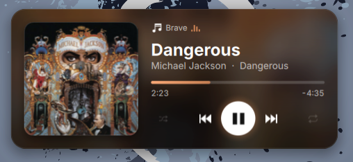
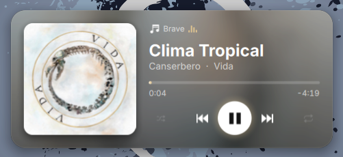
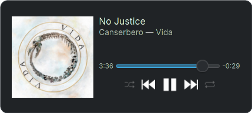

# Reproductor de música — widget para KDE Plasma 6

Plasmoide con un reproductor moderno para cualquier app compatible con MPRIS: Spotify, Elisa, VLC, mpv, Brave, Firefox, Chrome…

## Capturas

### Estilo moderno

| Portada oscura | Portada clara |
|---|---|
|  |  |

El fondo y el color de la barra de progreso se adaptan a cada portada.

### Estilo Plasma



Usa los componentes y colores de tu tema de Plasma.

## Qué hace

- Portada con esquinas redondeadas y, de fondo, la misma portada desenfocada.
- Toma el color de acento de la portada para la barra de progreso y el brillo del botón de play.
- Barra de progreso que se puede arrastrar o clicar para adelantar.
- Botones de anterior, play/pausa, siguiente, aleatorio y repetir (lista → canción → apagado).
- Rueda del mouse sobre el widget para subir o bajar el volumen (sale el OSD de Plasma).
- Clic en la portada para traer al frente la app que está sonando.
- Si tienes varias apps reproduciendo, aparecen sus íconos arriba a la derecha para cambiar entre ellas.
- **En el panel** se ve la miniatura de la portada con barritas de ecualizador:
  - Clic: abre la tarjeta completa.
  - Clic medio: play/pausa.
  - Rueda: volumen.
  - Botones atrás/adelante del mouse: canción anterior/siguiente.
  - Se oculta solo cuando no hay nada sonando.

## Estilos

Clic derecho en el widget → **Configurar** → **Apariencia**:

- **Plasma**: componentes y colores de tu tema (respeta claro/oscuro, el color de acento y el fondo normal de los widgets). Se ve como los widgets que trae KDE.
- **Moderno** (por defecto): tarjeta oscura con efectos.

Solo se carga el diseño elegido: cada estilo vive en su propio archivo (`FullRepresentationPlasma.qml`, `FullRepresentationModern.qml`, …) y `StyleLoader.qml` abre únicamente el que toca.

### Agregar un estilo nuevo

1. Crea `contents/ui/FullRepresentation<Nombre>.qml` y `contents/ui/CompactRepresentation<Nombre>.qml`. Toman los datos y acciones de `root` (definidos en `main.qml`).
2. Agrega la opción en `contents/ui/configAppearance.qml` y su nombre en `StyleLoader.qml`.

## Consumo

Sin animaciones continuas: las barritas solo se mueven al pasar el mouse, y el blur del fondo se calcula una vez por portada. Con música sonando usa ~0% de CPU en reposo.

## Requisitos

- KDE Plasma 6.0 o superior.

## Instalación

```bash
cd music-widget
kpackagetool6 --type Plasma/Applet --install .
```

Después: clic derecho en el escritorio o en el panel → **Añadir o gestionar widgets** → busca **Reproductor de música**.

### Actualizar

```bash
kpackagetool6 --type Plasma/Applet --upgrade .
```

Si no ves los cambios, reinicia Plasma:

```bash
systemctl --user restart plasma-plasmashell
```

### Probar en una ventana sin tocar el escritorio

```bash
plasmawindowed local.musicplayer
```

### Desinstalar

```bash
kpackagetool6 --type Plasma/Applet --remove local.musicplayer
```

## Archivos

| Archivo | Para qué |
|---|---|
| `contents/ui/main.qml` | Conexión con MPRIS y acciones (play, siguiente, volumen…) |
| `contents/ui/FullRepresentationModern.qml` | La tarjeta completa (estilo moderno) |
| `contents/ui/CompactRepresentationModern.qml` | La miniatura del panel (estilo moderno) |
| `contents/ui/FullRepresentationPlasma.qml` | La vista completa (estilo Plasma) |
| `contents/ui/CompactRepresentationPlasma.qml` | El ícono del panel (estilo Plasma) |
| `contents/ui/StyleLoader.qml` | Carga solo el estilo elegido |
| `contents/ui/configAppearance.qml` | Pantalla de configuración |
| `contents/ui/SeekBar.qml` | Barra de progreso |
| `contents/ui/ControlButton.qml` | Botones redondos |
| `contents/ui/RoundedImage.qml` | Portada con esquinas redondeadas |
| `contents/ui/Equalizer.qml` | Barritas de ecualizador (se animan al pasar el mouse) |
